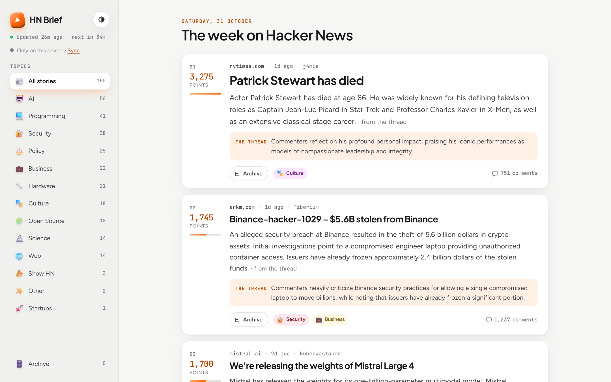
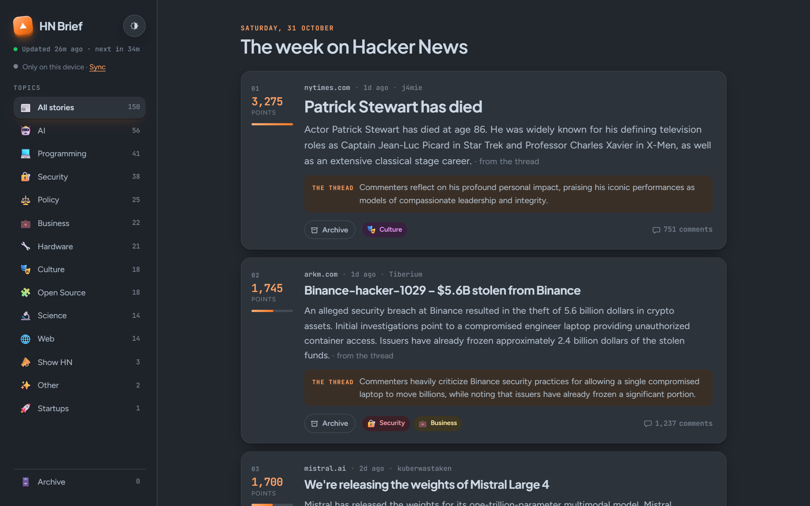

# Clean Hacker News

Read only the Hacker News stories worth your time: the week's top posts, each with a short AI summary, so you know what a link is about before you open it.

**Live:** [cleanhackernews.netlify.app](https://cleanhackernews.netlify.app)

| Light | Dark |
|---|---|
|  |  |

- **Know before you click.** Every story has a 2–3 line summary of the article and one line on what the commenters think.
- **Read stories stay gone.** Opening or archiving a story removes it from your list, on every device. You only need a passphrase you choose; there's no account.
- **The best of the week, not just today.** A big story from four days ago still beats a small one from this morning (see ranking below).
- **Extras:** topic filters, an Archive tab with the last 3 days (restore anything), light and dark mode, and links to the comments and the poster's profile.

## Get your own

You need an **AWS account** and a **Gemini API key** (free from [Google AI Studio](https://aistudio.google.com/apikey)).

Paste this repo's link into an AI coding agent such as [Claude Code](https://claude.com/claude-code) and ask: *"Deploy this to my AWS account."* It follows [AGENTS.md](AGENTS.md) and asks you only for what it needs.

<details>
<summary>How stories are ranked</summary>

- The pool is every Hacker News story from the **past 7 days with at least 100 points**.
- Each story is scored by its **points, minus 5% for each day of age**. Points still decide almost everything; the small penalty only settles close calls in favour of the newer story.
  - 500 points today beats 550 points a week ago (550 counts as about 385).
  - 1,000 points five days ago still beats 700 points today (1,000 counts as about 775).
- The **top 150** are shown, highest first. The list refreshes every hour, so new stories climb as they collect votes.

</details>

<details>
<summary>How it works</summary>

| Part | Service | What it does |
|---|---|---|
| Hourly refresh | EventBridge Scheduler → Lambda | Fetches the week's top stories, reads each new article and its top comments, asks Gemini for the summary, tags and comment line, and writes `stories.json` |
| Summaries | Gemini API | Newest Flash model, falling back to Flash-Lite when Flash is busy or out of quota. Each story is summarised once. |
| Website | S3 + CloudFront | Serves the page and `stories.json`; the page builds itself in your browser |
| Read-list sync | API Gateway → Lambda → DynamoDB | Stores which stories each passphrase has read, plus 3 days of titles for the Archive tab |
| API key | SSM Parameter Store | Keeps the Gemini key encrypted |

Everything is defined in `template.yaml` and deployed with the plain AWS CLI. Nothing runs between refreshes, so AWS costs stay at or near the free tier. Gemini costs a few cents a day on a paid key; the free tier also works, with Flash-Lite doing most summaries.

</details>

<details>
<summary>Manual setup (Windows, PowerShell)</summary>

1. Install [Node.js](https://nodejs.org) (version 20 or newer) and the [AWS CLI](https://aws.amazon.com/cli/), then run `aws configure` and sign in to your AWS account.
2. Download this repo and open a terminal in its folder.
3. Run `npm install`.
4. Store your Gemini key. Your typing is hidden and goes straight to AWS:
   ```powershell
   powershell -ExecutionPolicy Bypass -File scripts/set-secrets.ps1
   ```
5. Deploy. The first run takes about 5 minutes and prints your site's address at the end:
   ```powershell
   npm run deploy
   ```
6. Optional short address: put your site address into `forwarder/netlify.toml` and drag the `forwarder` folder onto [app.netlify.com/drop](https://app.netlify.com/drop).

To preview locally first: `npm run refresh:mock` (real stories, placeholder summaries), then `npm run dev` and open http://localhost:5173.

To remove everything: empty the site bucket, then run `aws cloudformation delete-stack --stack-name hn-reader`.

</details>
